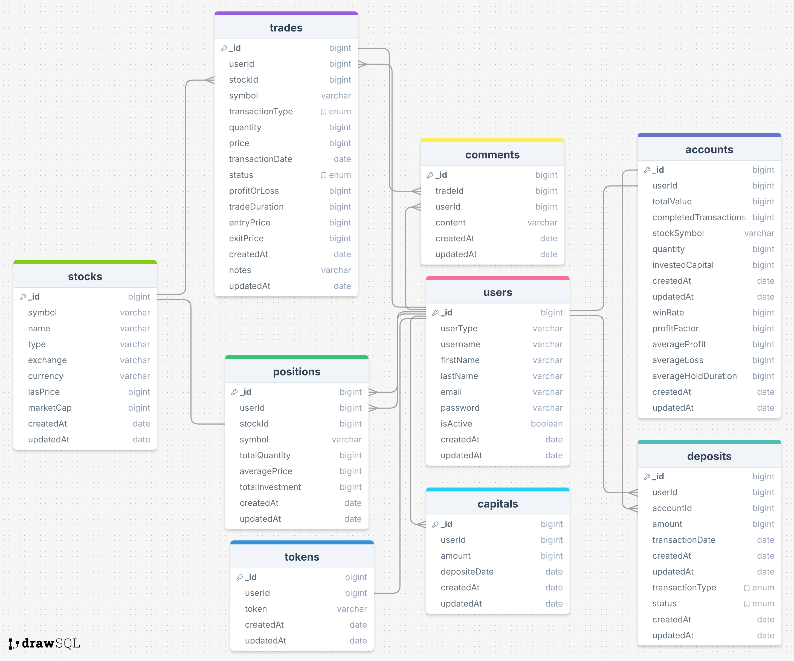

Projekt: Trade Journal
Produktvision
Das Projekt "Trade Journal" zielt darauf ab, eine webbasierte Plattform bereitzustellen,
auf der Mitglieder ihre Handelsaktivitäten protokollieren, verfolgen und analysieren
können. Die Plattform soll einfach und intuitiv zu bedienen sein, visuell ansprechend und
übersichtlich gestaltet sein und umfangreiche Einblicke bieten, um die
Handelsentscheidungen der Benutzer zu verbessern.
Anforderungen
Die funktionalen Anforderungen sind nach Priorität sortiert.
Funktional

1. Eingabe von getätigten Orders auf Aktien
   Mitglieder sollten in der Lage sein, Details zu ihren getätigten Handelsaufträgen,
   einschließlich Aktiensymbol, Handelsdatum, Anzahl und Preis, einzugeben.
2. Übersicht aller getätigten Orders (History)
   Die Plattform sollte eine übersichtliche und leicht zugängliche Historie aller vom
   Benutzer getätigten Handelsaufträge bieten.
   Es sollte eine Filterfunktion nach Aktiensymbol geben, um Trades leichter zu
   finden.
3. Anzeige abgeschlossener Trades
   Die Plattform sollte eine Übersicht über abgeschlossene Trades bieten. Es sollte
   eine Filterfunktion nach Aktiensymbol geben, um Trades leichter zu finden.
4. Anzeige offener Aktienpositionen
   Mitglieder sollten in der Lage sein, ihre aktuellen offenen Aktienpositionen
   einzusehen, einschließlich der Anzahl der gehaltenen Aktien und des investierten
   Kapitals.
5. Auswertung von Trades
   a. Gewinn/Verlust pro Trade
   b. Wie lange lief der Trade
6. Eingabe des eingezahlten Kapitals ins Depot
   Mitglieder sollten die Möglichkeit haben, das in ihr Depot eingezahlte Kapital
   einzugeben.
7. Auswertung Depot
   a. Anzeige aktueller Depotwert
   b. Anzahl abgeschlossener Trades
   c. Trefferwahrscheinlichkeit (Anteil der Trades mit Gewinn zu Anzahl
   gesamter Trades)
   d. Profitfaktor (Gewinne/Verluste)
   e. Durchschnittsgewinn/Verlust
   f. Durchschnittliche Haltedauer
8. Eingabe von Learnings zu einem Trade (Notizfeld)
9. Eingabe eines Kommentars zu einer Order
   Nicht Funktional
   ● Ansprechende und moderne UI
   ● Validierung bei Dateneingabe
   ● Daten werden persistent gespeichert
   ● Im Browser aufrufbar (Einfache Executable für Windows oder MacOS oder
   gehostet)
   ● Technologien sind frei wählbar

---

# Trade-Plattform - Full Stack Developer Aufgabe

Dieses Projekt wurde erstellt, um eine Beispiel-**Trade-Plattform** zu entwickeln. Es wurde mit den folgenden Technologien realisiert:

- **Frontend:** React, Tailwind CSS, Redux (State Management)
- **Backend:** Node.js, MongoDB
- **Tools:** Vite, pnpm, nodemon

## 📂 Projektstruktur

- **frontend/**: Frontend entwickelt mit React und Tailwind CSS.
- **backend/**: Backend entwickelt mit Node.js und MongoDB.

## 🚀 Installation und Ausführung

Das Projekt läuft in zwei separaten Umgebungen: **Frontend** und **Backend**. Befolgen Sie die folgenden Schritte, um beide Umgebungen einzurichten und zu starten.

### 1. Voraussetzungen

Stellen Sie sicher, dass die folgenden Tools auf Ihrem System installiert sind:

- **Node.js** (v16 oder höher)
- **pnpm** (Paketmanager)
- **MongoDB** (Lokal oder Cloud-Instanz)

### 2. Klonen des Projekts

Klonen Sie das Projekt von GitHub oder einer anderen Quelle:

```bash
git clone https://github.com/karamanburak/trade-journal.git
cd <repository-folder>
```

```dotnetcli
cd client
pnpm install
pnpm dev
```

```dotnetcli
cd server
npm install
```

npm install -g nodemon

🛠️ Technologien
Frontend:
React
Tailwind CSS
Redux
Vite
Backend:
Node.js
MongoDB
[Express](https
.js/)

### ERD:



Hinweis: Für alle sicherheitsrelevanten Informationen (wie Passwörter) bitte die .env-Datei überprüfen.

Verwendung
Benutzer müssen sich registrieren und anmelden.
Nach der Anmeldung kann der Benutzer auf die Profilseite zugreifen.
Auf der Profilseite kann der Benutzer Geld auf sein Konto einzahlen.
Anschließend kann er beliebige Trade-Transaktionen durchführen.
E-Mail-Benachrichtigungen
Wenn ein Benutzer sich registriert, erhält er eine Bestätigungs-E-Mail.
Sobald der Benutzer eine Trade-Transaktion durchführt, wird eine Transaktionsbestätigung per E-Mail gesendet.
Diese Funktion wird mit Nodemailer implementiert.

## Documentations

- [View Postman Documentation](https://documenter.getpostman.com/view/32987022/2sAYBRGuMA)
- [View Swagger Documentation](http://127.0.0.1:8000/api/v1/documentations/swagger/)
- [View Redoc Documentation](http://127.0.0.1:8000/api/v1/documentations/redoc)
- [View Json Documentation](http://127.0.0.1:8000/api/v1/documentations/json)
